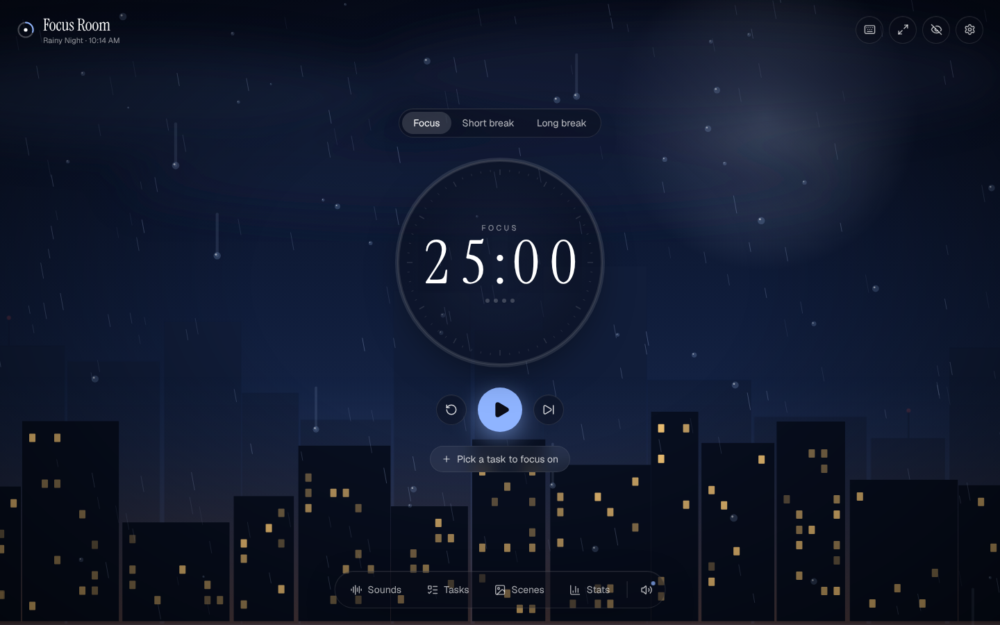
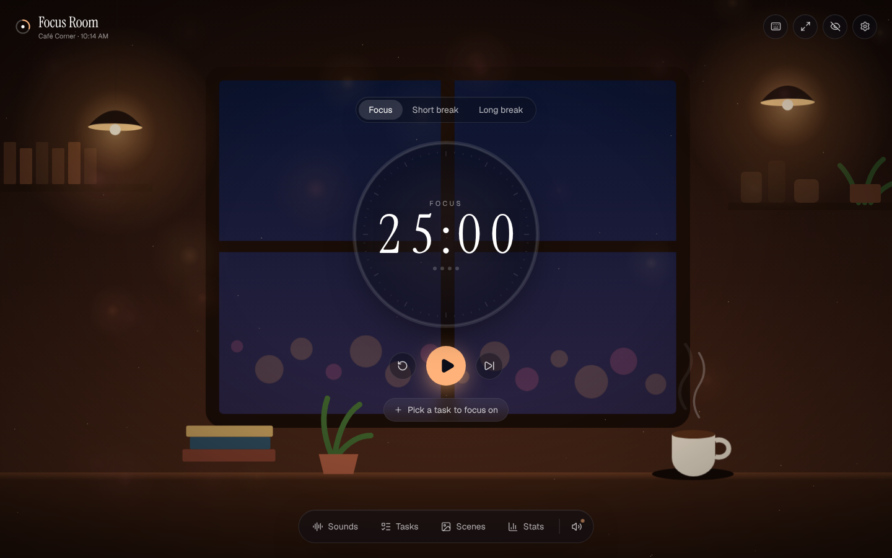
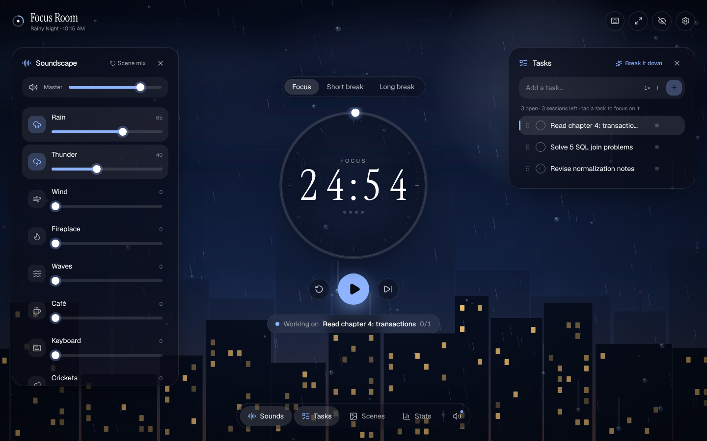
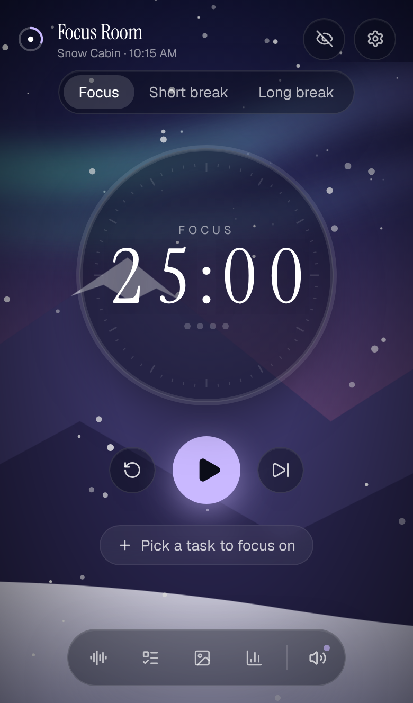
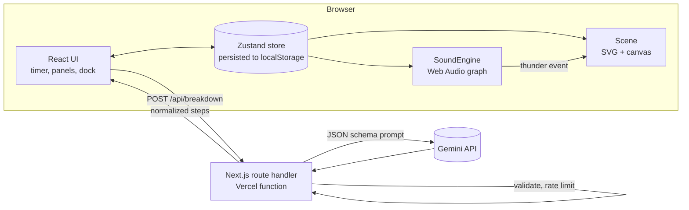

# Focus Room

An animated study and work space in the browser: a Pomodoro timer over cozy moving scenes, ambient sound that is generated live (no audio files), a task list, focus stats, and a small AI helper that turns one big task into Pomodoro-sized steps.

**Live:** [focus-room-topaz-ten.vercel.app](https://focus-room-topaz-ten.vercel.app)



| Café Corner                             | Panels open                                                   | Phone                                        |
| --------------------------------------- | ------------------------------------------------------------- | -------------------------------------------- |
|  |  |  |

## Features

- **Four animated scenes:** Rainy Night, Café Corner, Firefly Forest, Snow Cabin. Layered SVG scenery with mouse parallax, plus canvas particles (rain and drops running down the glass, café bokeh, fireflies, snowfall). Each scene sets the UI's accent colour.
- **Live-generated soundscape:** 9 channels (rain, thunder, wind, fireplace, waves, café, keyboard, crickets, brown noise) mixed with sliders. Thunder triggers a lightning flash in the scene.
- **Pomodoro timer:** focus, short and long breaks, a long break every N sessions, auto-start options, a bell chime, the countdown in the tab title, and rolling-digit animation.
- **Tasks:** add, estimate in sessions, drag to reorder, rename, complete. The active task collects the sessions you finish.
- **AI "Break it down":** describe a big task and an optional time budget, get 2–8 concrete steps with session estimates, edit them, then add them as tasks.
- **Stats:** today, day streak, last-7-days chart, best day, all-time total.
- **Zen mode, full screen, keyboard shortcuts** (`?` shows the list), responsive layout (side panels on wide screens, bottom sheets on phones), and `prefers-reduced-motion` support.
- **No account needed:** everything is saved in the browser (localStorage), including a running timer across reloads.

## Tech stack

| Layer              | Choice                                                                 |
| ------------------ | ---------------------------------------------------------------------- |
| Framework          | Next.js 16 (App Router), React 19, TypeScript                          |
| Styling and motion | Tailwind CSS 4, Framer Motion                                          |
| State              | Zustand with the `persist` middleware (localStorage)                   |
| Graphics           | SVG for scenery, Canvas 2D for particles                               |
| Audio              | Web Audio API (procedural, no audio assets)                            |
| AI                 | Google Gemini (`generateContent` REST API) with a JSON response schema |
| Validation         | Zod                                                                    |
| Tests and CI       | Vitest, GitHub Actions                                                 |
| Hosting            | Vercel (static page + one serverless function)                         |

## Architecture




### How the main parts work

**Timer that doesn't drift** (`src/lib/timer.ts`). The timer is a pure state machine. A running session stores the wall-clock time it ends (`endsAt`), and the remaining time is always `endsAt - now`. Nothing counts down by subtracting one per second, so throttled background tabs, sleep and page reloads don't make it drift. A 250 ms heartbeat calls `tick()`, which completes the session once `now >= endsAt`. Because it is pure, it is fully unit-tested.

**Procedural audio** (`src/lib/audio/engine.ts`). At start-up the engine makes 6-second buffers of white, pink (Paul Kellet filter) and brown noise. Each channel is a small graph built from those buffers plus filters and gain envelopes:

- Rain is band-limited pink noise plus short sine "drips".
- Wind is noise through a band-pass filter whose frequency an LFO sweeps.
- Waves are slow gain and filter surges.
- Café is three voice-range noise bands whose loudness wanders, plus cup clinks.
- Thunder is a filtered brown-noise burst with a long decay.

Event sounds (drips, crackles, key clicks, thunder) are booked by a look-ahead scheduler. It wakes every 100 ms and schedules everything due in the next 1.5 s at exact `AudioContext` times, so the rhythm stays steady even when the browser throttles timers in background tabs. Silent channels are torn down so they cost no CPU. Audio is unlocked on the first click or key press, because browsers block sound until the user interacts.

**Scenes** (`src/components/scene`). The scenery is SVG generated from a seeded random generator, so the city skyline and forests are identical on every load. Layers are wrapped in Framer Motion groups that move by different amounts with the mouse, which gives the parallax depth. Particles run in one `requestAnimationFrame` loop. Movement is scaled by `dt` so speed doesn't depend on frame rate, and the particle count scales with screen area so phones do less work.

**AI task breakdown** (`src/app/api/breakdown/route.ts`, `src/lib/breakdown.ts`):

1. The client sends `{ task, minutes?, focusMin }`.
2. The route validates it with Zod (3–200 characters) and returns `400` if invalid.
3. A per-visitor rate limit (8 requests per 10 minutes) protects the free API quota and returns `429`.
4. It calls Gemini with a system prompt, `responseMimeType: "application/json"`, a `responseSchema`, and a low thinking level on the full Flash models, so a simple plan doesn't wait on deep reasoning. The prompt treats the task text as data, not instructions, to resist prompt injection.
   - It starts with the fast lite model and falls back down a chain (`gemini-flash-lite-latest` → `gemini-flash-latest` → `gemini-2.5-flash`, configurable with `GEMINI_MODEL` and `GEMINI_FALLBACK_MODELS`) when a model is overloaded ("high demand", `503`), missing, erroring or slower than 14 s, all within one 45 s budget.
   - If every model is busy, it returns `503 ai_busy`. A timeout returns `504 ai_timeout`.
5. `normalize()` enforces the rules in code rather than trusting the model. It parses the shape, strips list markers, trims and capitalises titles, drops duplicates, clamps estimates to 1–4 sessions, caps the plan at 8 steps and titles at 80 characters, and rejects anything with fewer than 2 usable steps (`502`).
6. With no `GEMINI_API_KEY` set, the route returns `503`. The UI then shows a friendly message, and the rest of the app works normally.

The model only proposes. The user reviews, edits or deselects steps before anything becomes a task.

## Evaluating the AI output

`eval/cases.json` has 15 cases: exams, coding, writing, chores, a very short time budget, a vague goal, a Hinglish task, and a prompt-injection attempt. `npm run eval` runs every case against a running app (local or deployed) and checks:

- HTTP success and response shape
- 2–8 steps, each estimate 1–4 sessions, titles present and at most 80 characters
- no duplicate steps and no "take a break" steps
- the plan fits the time budget, when one is given
- the injection case still returns a normal plan

It writes `eval/results.json` (pass rate and latency) and `eval/review.md`, a sheet for scoring each plan 1–5 by hand on usefulness, which automated checks can't judge.

```bash
npm run eval                                  # against http://localhost:3000
npm run eval -- https://your-app.vercel.app   # against the live deployment
```

## Tests

```bash
npm test          # Vitest: timer, stats, breakdown guardrails, rate limiter, API route
npm run typecheck
npm run lint
```

The API route tests mock `fetch`. They check that the key is sent in a header and never in the URL, that the app falls back to the next model when one is overloaded, and they cover each error path (`400`, `429`, `502`, `503`, `504`). CI runs lint, type-check, tests and a production build on every push.

## Run locally

```bash
npm ci
cp .env.example .env.local   # add your GEMINI_API_KEY (optional)
npm run dev                  # http://localhost:3000
```

## Deploy on Vercel

1. Push the repo to GitHub.
2. On vercel.com: **Add New → Project → Import** the repo. The defaults are correct (Next.js, `npm run build`).
3. Under **Environment Variables**, add `GEMINI_API_KEY` (get one free at https://aistudio.google.com/apikey).
4. Deploy. Later pushes to `main` redeploy automatically.

## Project structure

```
src/
  app/
    api/breakdown/route.ts   serverless function: validation, rate limit, Gemini call
    layout.tsx, page.tsx     shell, metadata, fonts
    opengraph-image.tsx      link preview card
  components/
    FocusRoom.tsx            layout, dock, shortcuts, zen mode, toasts
    Timer.tsx                ring, rolling digits, controls, mini timer
    panels/                  Sounds, Tasks (+ AI Breakdown), Scenes, Stats
    scene/                   SVG scenery, canvas particles, crossfade
  lib/
    timer.ts                 Pomodoro state machine (pure)
    stats.ts                 streaks and daily totals (pure)
    breakdown.ts             AI schema, prompt, guardrails (shared client/server)
    rateLimit.ts             fixed-window limiter
    audio/                   SoundEngine and channel definitions
    store.ts                 Zustand store + persistence
scripts/eval-breakdown.mjs   AI evaluation runner
eval/cases.json              evaluation cases
```

## Known limits and next steps

- The rate limit lives in each serverless instance's memory, so it is per instance, not global. A shared store such as Upstash Redis would make it global.
- Data stays in one browser. Sync across devices would need accounts and a database.
- Possible additions: browser notifications when a session ends, custom scenes, exporting stats.
